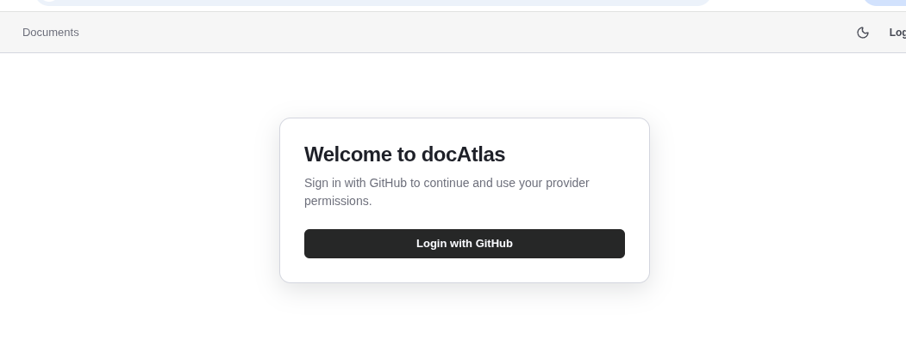
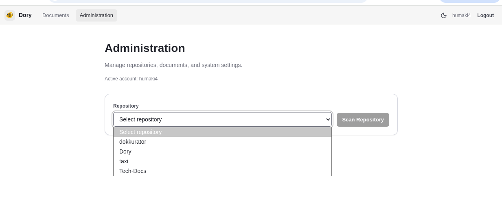
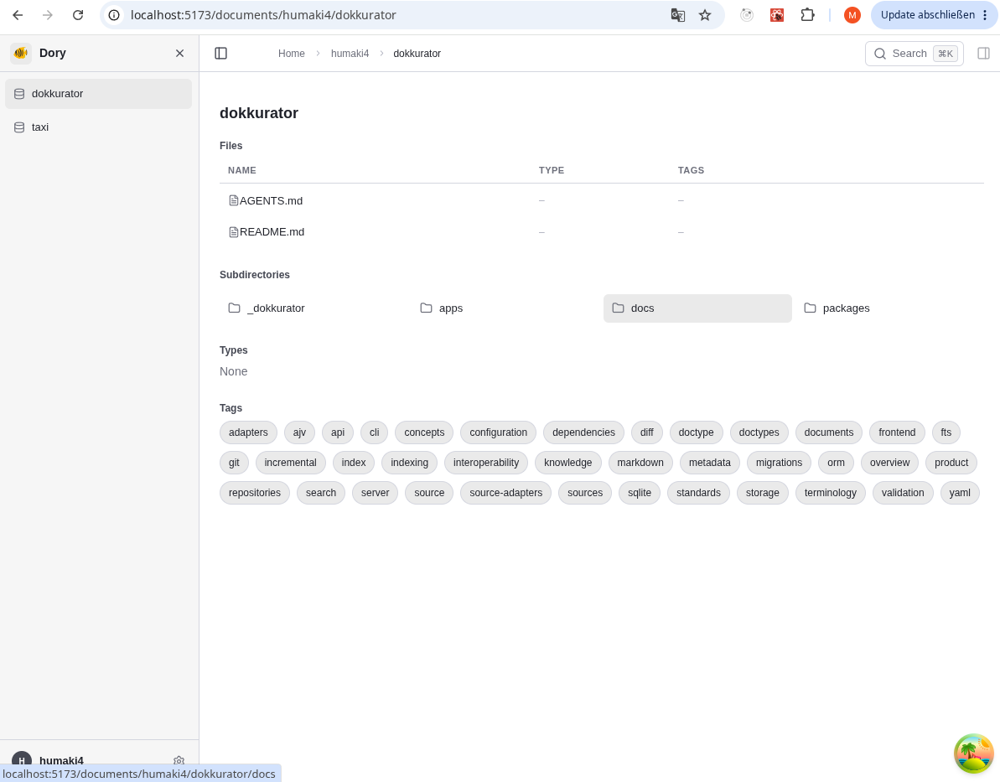
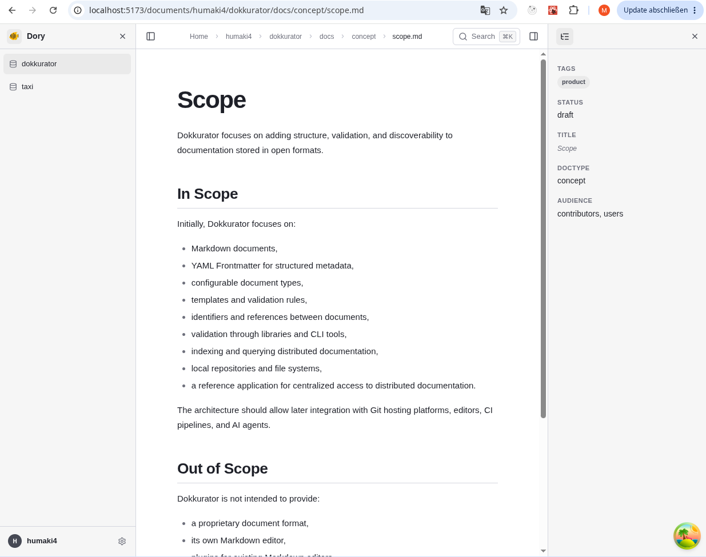
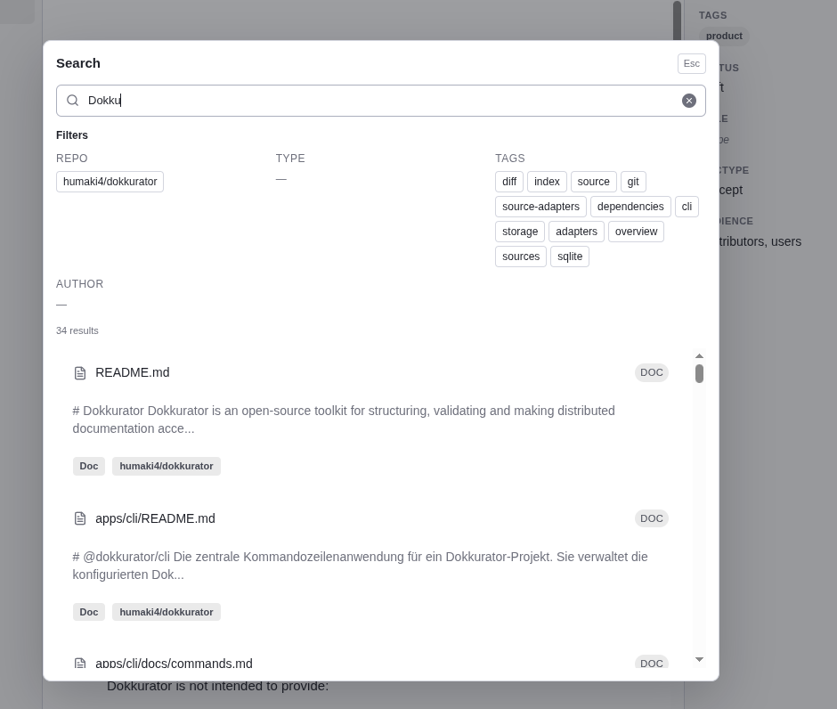

# docAtlas

docAtlas ist ein Prototyp fuer eine git-native Dokumentations- und Wissensplattform. Die Idee: Markdown-Dateien bleiben in ihren fachlichen Repositories, docAtlas sammelt sie ein, normalisiert Metadaten aus Frontmatter, speichert sie zentral in MongoDB und macht sie in einer Weboberflaeche durchsuchbar und browsebar.

> **WICHTIG:** Dies ist nur ein Proof of Concept.
>
> **- Nicht für den Einsatz gedacht -**
>
> secret handling teils noch in .env, einige Endpoints noch nicht sauber abgesichert, config inkonsistent etc.

## Teilbereiche

- [client/README.md](./client/README.md) beschreibt das React-Frontend.
- [server/README.md](./server/README.md) beschreibt das Fastify-Backend.
- [docs/README.md](./docs/README.md) sammelt Produkt-, Architektur- und Beispieldokumentation.

## Idee

In vielen Teams liegt Dokumentation verteilt ueber mehrere Repositories: ADRs, How-Tos, RFCs, Projektmanagement-Artefakte, Meeting Notes oder Produktkonzepte. docAtlas soll diese verteilten Inhalte nicht ersetzen, sondern erschliessen.

Der Kernansatz ist:

- Dokumente bleiben im Git-Repository, in dem sie fachlich hingehoeren.
- Ein Collector liest diese Inhalte ueber Provider-APIs ein.
- Frontmatter und Dateiinhalte werden in MongoDB gespeichert.
- Das Frontend bietet einen zentralen Einstieg fuer Suche, Navigation und Sichtbarkeit nach Benutzerrechten.

## Was der Prototyp aktuell zeigt

- Login ueber OAuth, aktuell primaer mit GitHub, optional mit GitLab.

	

- Administrationsbereich zum Laden scanbarer Repositories und zum Starten eines Scans.
- Ingestion von Markdown-Dokumenten inklusive Metadaten nach MongoDB.

	

- Dokumentbrowser fuer Repositories und Pfade.

	
	

- Suche ueber die in MongoDB gespeicherten Dokumente.

	

- Repository-basierte Sichtbarkeit anhand der Berechtigungen des eingeloggten Users.

## Fazit

Das Einsammeln der Dokumentation aus den Repositories ist technisch machbar und als zentraler Einstieg sinnvoll. Allerdings:

- die Verzeichnisstruktur wird vom Sourcecode vorgegeben, so wirkt die Dokumentation im Browser zerklüftet
- ein zentraler Zugriff allein auf Basis von Pfaden und Inhalten ist daher nicht ausreichend.
- die Qualität der Dokumentation ist oft inkonsistent
- Aktualität und Relevanz der Dokumente sind oft nicht eindeutig erkennbar.

Deshalb wären zusätzliche Werkzeuge zur Qualitätssicherung und zur Anreicherung von Metadaten wären sinnvoll:

- Prüfungen auf Struktur, Vollständigkeit und Aktualität
- sowie standardisierte Metadaten für Dokumenttyp, Zuständigkeit, Status und fachliche Relevanz.

Mit den zusätzlichen Metadaten könnte eine alternative Struktur und Gruppierung geschaffen werden und das Browsing erleichtern.

## Systemaufbau

- `client/`: React 19, Vite, TanStack Router und TanStack Query.
- `server/`: Fastify 5 mit Plugins fuer Auth, Repository-Zugriff, Events, Collector, Documents und Search.
- `MongoDB`: einzige persistente Datenquelle und auch Grundlage fuer die aktuelle Suche.
- `docs/`: Produktidee, Aufgaben, Architektur und Beispieldokumente.

Wichtig: MeiliSearch ist nicht mehr Teil des aktiven Aufbaus. Die aktuelle Suchfunktion laeuft ueber MongoDB.

## Docker-Aufbau

Es gibt im Repository zwei Compose-Dateien mit unterschiedlichem Zweck:

### `docker-compose.dev.yml`

Diese Datei startet aktuell nur die gemeinsame Entwicklungsdatenbank.

- `mongodb`: MongoDB 7
- Volume: `mongodb_data`
- Bridge-Netzwerk: `dory-network`

Das ist der naheliegende Entwicklungsmodus: Datenbank in Docker, Server und Client lokal mit Hot Reload.

### `docker-compose.yml`

Diese Datei beschreibt den kompletten Container-Aufbau.

- `mongodb`: persistente Datenhaltung
- `server`: Fastify-Backend auf Port `3000`
- `client`: Nginx-Container fuer das gebaute Frontend auf Port `80`

Der Client leitet dabei `/api` an den Service `server:3000` weiter. Ein separater Search-Container existiert nicht mehr.

## ENV-Dateien

Der Server laedt Konfiguration aus mehreren Dateien. Die Reihenfolge ist wichtig, weil spaeter geladene Dateien fruehere Werte ueberschreiben:

1. `server/.env`
2. `server/.env.local`
3. `.env`
4. `.env.local`

Praktisch bedeutet das:

- Root-ENV-Dateien eignen sich fuer gemeinsame lokale Projektkonfiguration.
- `server/.env.local` eignet sich fuer backend-spezifische Overrides.
- `.env.local` ist der staerkste lokale Override, wenn du den Server aus `server/` startest.

Der Client liest aktuell keine `import.meta.env`-Variablen aus dem Anwendungscode. Im Dev-Modus nutzt Vite stattdessen einen Proxy von `/api` auf `http://localhost:3000`.

### Fuer Docker Compose relevante Variablen

Diese Variablen werden direkt in den Compose-Dateien verwendet:

- `MONGODB_USERNAME`
- `MONGODB_PASSWORD`
- `MONGODB_DATABASE`
- `GITHUB_TOKEN`
- `GITLAB_TOKEN`

### Fuer den Server relevante Variablen

Die vollstaendige Liste steht in [server/README.md](./server/README.md). Im Alltag sind diese Gruppen zentral:

- MongoDB: `MONGODB_URI`
- Serverlaufzeit: `PORT`, `NODE_ENV`, `LOG_LEVEL`
- OAuth allgemein: `AUTH_JWT_SECRET`, `AUTH_BACKEND_PUBLIC_URL`, `AUTH_CLIENT_SUCCESS_REDIRECT_URL`
- GitHub OAuth: `AUTH_GITHUB_CLIENT_ID`, `AUTH_GITHUB_CLIENT_SECRET`
- GitLab OAuth optional: `AUTH_GITLAB_ENABLED`, `AUTH_GITLAB_CLIENT_ID`, `AUTH_GITLAB_CLIENT_SECRET`
- Rollen und Sichtbarkeit: `AUTH_ADMIN_USERS`, `AUTH_ADMIN_ORGS`, `AUTH_ADMIN_TEAMS`, `AUTHZ_REPO_CACHE_TTL_MS`
- Collector/Provider: `PROVIDER_TYPE`, `GITHUB_TOKEN`, `GITLAB_TOKEN`, `GITLAB_BASE_URL`, `COLLECTOR_STARTUP_SYNC_ENABLED`

## Typischer Ablauf in der Anwendung

1. Der Benutzer oeffnet die Weboberflaeche und meldet sich per OAuth an.
2. Das Backend legt eine Session an und ermittelt Rollen und sichtbare Repositories.
3. Im Administrationsbereich werden scanbare Repositories geladen.
4. Ein Scan zieht Markdown-Dateien ueber den konfigurierten Provider ein.
5. Dokumente, Inhalte und Frontmatter werden in MongoDB gespeichert.
6. Im Dokumentbrowser werden sichtbare Repositories und Inhalte geladen.
7. Die Suche durchsucht die in MongoDB abgelegten Dokumente ueber Textindexe und Fallback-Muster.

## Lokale Entwicklung

### Empfohlener Entwicklungsmodus

1. MongoDB starten:

```bash
docker compose -f docker-compose.dev.yml up -d
```

2. Backend starten:

```bash
cd server
npm install
npm run dev
```

3. Frontend starten:

```bash
cd client
npm install
npm run dev
```

Danach ist das Frontend standardmaessig unter `http://localhost:5173` erreichbar, das Backend unter `http://localhost:3000`.

## Weiterfuehrende Doku

- [client/README.md](./client/README.md)
- [server/README.md](./server/README.md)
- [docs/README.md](./docs/README.md)
# Tech-Docs
